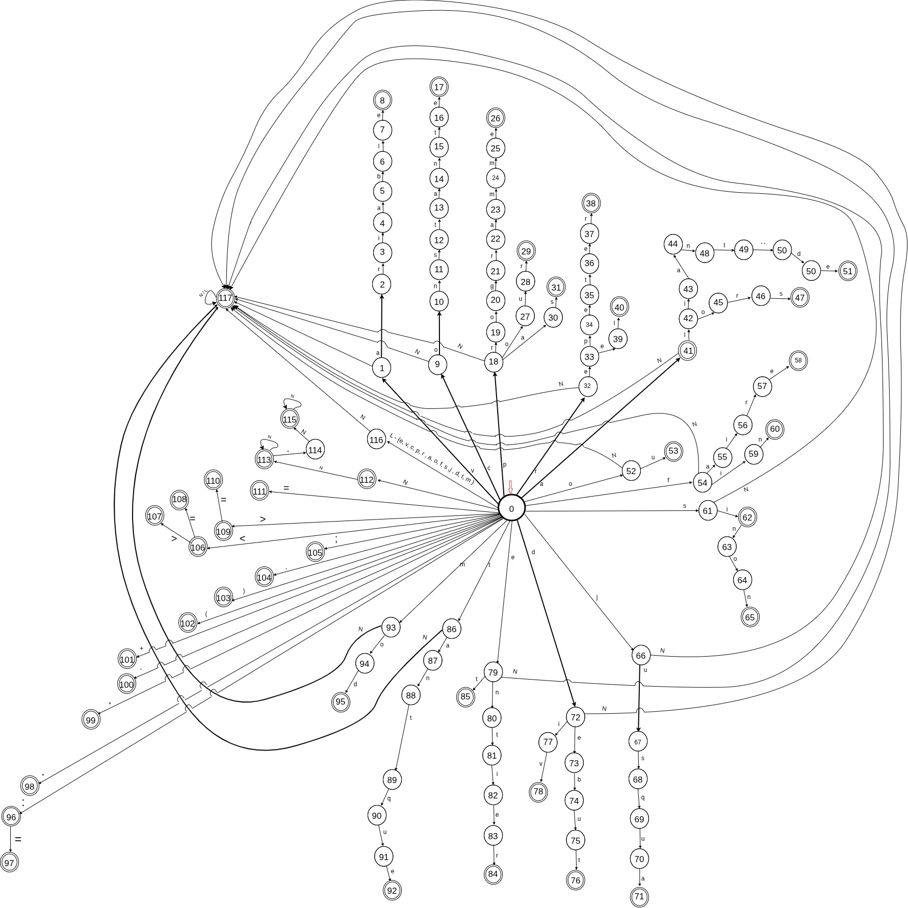

## MiniPascal-FR Compiler Project

# ⚠️ Note for Classmates
Using this repository to copy or cheat **will not help you improve your skills.** Building your own MiniPascal-FR compiler is the only way to truly learn and understand the concepts. If you need guidance or explanations, I’m here to help—ask questions, discuss ideas, and work through problems yourself. **The goal is learning, not copy-paste.**


## Overview
This project involves the design and implementation of a compiler for the MiniPascal-FR programming language. The compiler will consist of two main components:
1. **Scanner (Scanner2025):** Responsible for lexical analysis.
2. **Parser (Parser2025):** Responsible for syntactic analysis.

You can refer to the full assignment document here:  [TP-Comp-2025.pdf](TP-Comp-2025.pdf)

---

## Grammar of MiniPascal-FR
The grammar of the MiniPascal-FR language is defined in Backus-Naur Form (BNF):

### Program Structure
```
<ProgrammePascal> ::= programme <NomProgramme> ; <Corps> .
<Corps> ::= [<PartieDéfinitionConstante>] [<PartieDéfinitionVariable>] <InstrComp>
```

### Constants and Variables
```
<PartieDéfinitionConstante> ::= constante <DéfinitionConstante> {<DéfinitionConstante>}
<DéfinitionConstante> ::= <NomConstante> = <Constante> ;
<PartieDéfinitionVariable> ::= variable <DéfinitionVariable> {<DéfinitionVariable>}
<DéfinitionVariable> ::= <GroupeVariable> ;
<GroupeVariable> ::= <NomVariable> {, <NomVariable>} : <NomType>
<NomVariable> ::= <Nom>
<Nom> ::= <Lettre> <Chiffre> {<Lettre> / <Chiffre>}
<Lettre> ::= 'A' / 'B' / ... / 'Z' / 'a' / ... / 'z'
<Chiffre> ::= 0 / 1 / ... / 9
<NomType> ::= entier / reel
<NomConstante> ::= <Nom>
<Constante> ::= <Nombre> / <NomConstante>
<NomProgramme> ::= <Nom>
<Nombre> ::= <Chiffre> {<Chiffre>} / <Chiffre><Chiffre> {<Chiffre>} .<Chiffre>{<Chiffre>}
```

### Instructions
```
<InstrComp> ::= debut <Instruction> {; <Instruction>} fin
<Instruction> ::= <InstructionAffectation> / <InstructionSi> / <InstructionTantque> /
                   <InstructionRépéter> / <InstrComp> / <InstructionPour> / <Vide>
<InstructionAffectation> ::= <NomVariable> := <Expression>
<Expression> ::= <ExpressionSimple> [<OperateurRelationnel> <ExpressionSimple>]
<OperateurRelationnel> ::= < / > / = / <= / >= / <>
<ExpressionSimple> ::= [<OperateurSigne>] <Terme> {<OperateurAddition> <Terme>}
<OperateurSigne> ::= + / -
<OperateurAddition> ::= + / - / ou
<Terme> ::= <Facteur> {<OperateurMult> <Facteur>}
<OperateurMult> ::= * / div / mod / et
<Facteur> ::= <Constante> / <NomVariable> / (<Expression>)
<InstructionSi> ::= si <Expression> alors <Instruction> [sinon <Instruction>]
<InstructionTantque> ::= tantque <Expression> faire <Instruction>
<InstructionRépéter> ::= repeter <Instruction> jusqu’a <Expression>
<InstructionPour> ::= pour <NomVariable> allant de <Constante> a <Constante> [pas <Constante>] faire <Instruction>
<Vide> ::= ''
```

---

## Deterministic Finite State Automaton

The automaton implements the lexical recognition phase of the compiler.
It defines the set of valid tokens in the language and encodes them as deterministic state transitions.
Each transition consumes exactly one input symbol, ensuring that every prefix of the input leads to a unique next state.
Accepting states correspond to recognized token categories such as identifiers, keywords, operators, and numeric literals.
Non-accepting sink states capture invalid or ill-formed sequences.

The DFA guarantees total determinism over the input alphabet by providing an outgoing transition for every symbol in every state.
This structure enables direct simulation by the scanner module and produces token classifications without backtracking.
The diagram below serves as the formal specification of the automaton and must remain synchronized with the implementation.




---

## How to Run
- `cd src`.
- run `main.py` (no 3rd party libraries needed).

---

## TO-DO 
1. **Scanner Implementation:**
   - [X] Design and implement a scanner for the MiniPascal-FR language.
   - [X] Store the output in a file named `TOKEN`.
   - [X] Display the sequence of tokens, the symbol table, and any errors with their types on the screen.

3. **Parser Implementation:**
   - [ ] Design and implement a recursive descent parser for the MiniPascal-FR language.
   - [ ] Store the output in a file named `RULE`.
   - [ ] Display the sequence of rules corresponding to the source program and any errors with their types on the screen.

---

## Deadlines
- **Scanner2025 Validation:** December 1, 2025
- **Parser2025 Validation:** January 12, 2026
